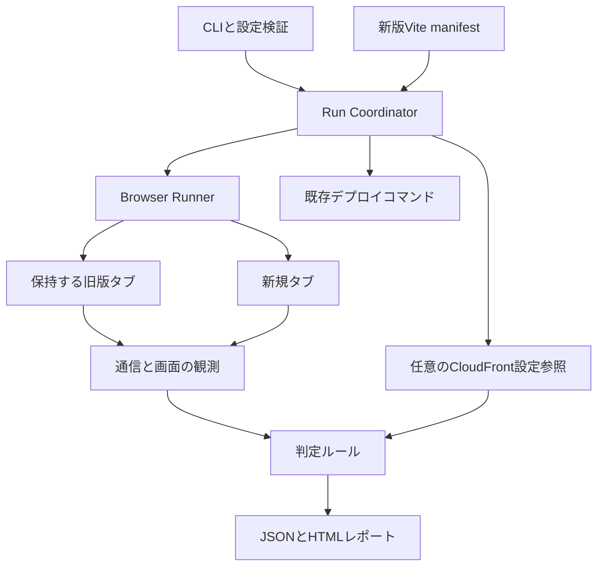
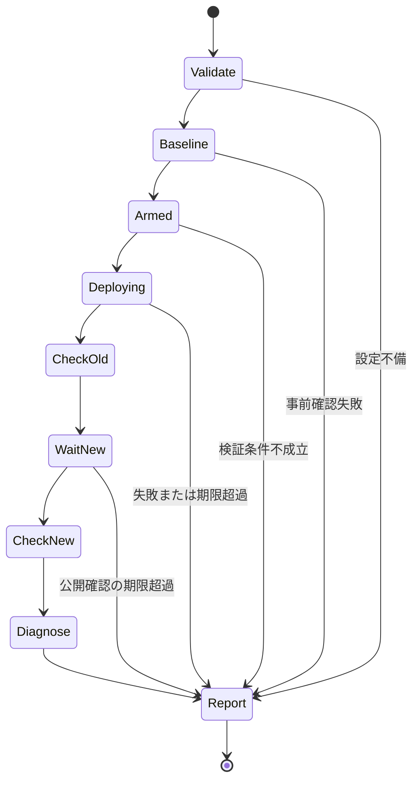

# Release Guard 設計

設計日: 2026-10-31。状態: ローカルで実行できる初期実装あり。CLI、ブラウザ検証、JSON設定、HTML／JSONレポート、任意のCloudFront設定参照を実装。実AWS環境の作成・接続・デプロイは未実施。

### 実装状況

実ブラウザを使うローカルテストとCloudFront APIの模擬応答で検証している。`npm run demo`で正常・旧版JS欠落・HTML誤配信の3ケースを再現できる。実行手順は[README](../../README.md)、公開設定は[JSON Schema](../../schemas/release-guard.schema.json)を参照。

実装では小さなモジュールを`src/*.ts`へ配置し、初期設計のモジュール境界を維持している。設定スキーマは`src/schema.ts`を正とし、公開JSON Schemaを生成、Ajvで実行時検証する。CLIはJSON設定を実行コードとして評価しない。

ルール`EXPECTED_ASSET_MISMATCH`は、明示した遅延ロード対象に一致する新版アセットとmanifestを照合する。未登録の全アセットを自動で既知の成果物へ対応付ける機能、レスポンス内容の完全一致検証、複数拠点、URL書き換え後の無効化診断は未実装。

2026-10-31のローカル確認: `npm run build`、`npm run schema:check`、`npm run test:coverage`が成功。57件のテストが通過し、行98.92%、分岐92.82%、関数84.62%。`npm audit`は既知の脆弱性0件。ビルド済みCLIでローカルの更新を1回実行し、終了コード0を確認した。`npm run demo`で正常1ケース・故障検出2ケースのレポートを保存した。GitHub上のCIと実AWSの確認は未実施。

## Overview

Release Guardは、CloudFront配信の更新に伴う利用者側の不具合を、デプロイ前から保持したブラウザと、新規ブラウザの比較で検出するCLIである。旧版の遅延読み込み失敗、JavaScriptに対するHTML応答、新版の公開未完了を主な検証対象とする。

想定利用者は、S3＋CloudFrontで業務画面・会員サイトを自社運用する開発チームと基盤チーム。毎回のデプロイに組み込み、手動再現と原因調査にかかる時間を減らす。

差別化の仮説は、旧版のブラウザ状態を保持する実行制御、配信成果物との照合、CloudFront設定に基づく説明を一体で提供すること。一般的なブラウザテストで実現可能な部分もあるため、初期ユーザーの導入時間と継続利用で価値を検証する。

### MVPの到達点

利用者が1つの操作シナリオを設定し、既存のデプロイコマンドをCLIで囲むと、旧版と新版の結果を区別したレポートが出る。初期導入の目標は30分以内、デプロイ時間を除く正常系の実行時間は1シナリオ60秒以内。これは測定前の製品目標であり、性能の実績ではない。

### 対象と境界

| 項目 | v0.1の設計 |
|---|---|
| アプリ | React／Viteの静的SPA。ビルド識別子とVite manifestを利用 |
| 配信 | S3＋標準CloudFront。所有するステージング環境から導入 |
| ブラウザ | Playwright付属Chromium、1実行拠点 |
| 実行環境 | Linux／WSL、単一のCIジョブ |
| シナリオ | 1〜3件。ページ表示、クリック、表示・文字列の検証 |
| 認証 | 任意の事前作成済みPlaywright認証状態ファイル。初期値は未認証 |
| 出力 | ターミナル要約、JSON、外部通信しない静的HTML |
| AWS連携 | 無効・任意・必須を選べるCloudFront設定参照 |

v0.1では、Next.js等のSSR、APIの新旧互換性、Service Worker、複数地域、負荷試験、自動修復、自動ロールバック、常設SaaS、独自のデプロイ基盤は扱わない。初期版はデプロイコマンド終了後の検証であり、デプロイ中の全瞬間の可用性を保証しない。

認証状態ファイルはテスト用アカウントのCookie等を与えるために使う。旧版ページのJavaScript実行状態の保存手段にはしない。ブラウザとページを生存させ続けることが、旧版検証の必須条件である。[PlaywrightのstorageState](https://playwright.dev/docs/api/class-browsercontext#browser-context-storage-state)

## 利用フロー

1. アプリのHTMLにビルド識別子を埋め込む。例: `<meta name="release-guard-build" content="build-20261031-002">`。新版のビルド生成時に期待値と一致させる。
2. Viteのmanifest出力を有効化し、新版の成果物をローカルに用意する。対象環境にはまだ旧版がある状態にする。[Viteのmanifest](https://vite.dev/guide/backend-integration)
3. 初期画面、操作、期待する画面、遅延ロードされるアセットのパターンを設定する。
4. CLIが旧版の動作確認と待機タブの準備を行う。
5. CLIが利用者指定のデプロイコマンドを子プロセスとして1回実行する。
6. 終了直後に保持していた旧版タブを操作し、新版は期限内に期待ビルドが表示されることを確認する。
7. 観測した不具合と原因候補を分けたレポートを生成し、CIへ終了コードを返す。

提案するCLIインターフェース:

```bash
release-guard validate --config release-guard.json
release-guard run --config release-guard.json -- node scripts/deploy-staging.mjs
```

`validate`は設定、環境変数の存在、ローカルmanifestを検証する。ブラウザ起動、AWS接続、デプロイは行わない。`run`は`--`以降を実行ファイルと引数に分割し、シェル展開を加えず実行する。`scripts/deploy-staging.mjs`は利用者の既存スクリプトを表す例であり、本プロジェクトには存在しない。

CIでは、ビルド→認証設定→`release-guard run ... -- 既存デプロイ`→レポート保存、を同一ジョブに置く。最後の保存処理は失敗時も実行する。デプロイ自体はこのラッパー内だけで実行し、先行ステップで重複実行しない。ジョブ分割やCookie復元で旧版タブを代用しない。

## Architecture



| モジュール | 責務 |
|---|---|
| `cli` | 引数、設定読込、終了コード、SIGINT／SIGTERM受付 |
| `config` | JSONの厳密検証、環境変数参照、パスと上限値の確認 |
| `coordinator` | 状態遷移、期限、デプロイ1回の制御、結果集約 |
| `browser` | コンテキストの準備、画面操作、ページ生存確認 |
| `observe` | 通信イベントと画面検証の収集、機密値の除去 |
| `artifacts` | Vite manifest解析、依存グラフとローカルファイル検証 |
| `cloudfront` | 設定の読み取りと必要フィールドへの縮約 |
| `diagnostics` | 実測結果と設定から、事実・原因候補・未検証を生成 |
| `report` | JSON、HTML、ターミナル表示を共通モデルから生成 |

DB、キュー、常駐サーバーは使わない。実行単位のメモリと出力ディレクトリで完結する。診断ルールは純粋関数に寄せ、ブラウザやAWSを起動せず検証可能にする。

## 実行制御



各状態からキャンセル・ブラウザ異常時に部分結果を生成できる。レポートの生成そのものが失敗した場合も、終了コードと最小のターミナル診断を返す。

### 旧版の準備と比較

- シナリオごとに、旧版の事前確認用コンテキストで操作を最後まで実行する。期待画面が表示され、指定した遅延ロードのリクエストが発生することを確認する。失敗ならデプロイを始めない。
- 次に別コンテキストを作成し、同じ初期画面まで進めた状態で保持する。このタブでは対象の遅延ロードをまだ発生させない。
- 事前確認と保持タブのHTMLビルド識別子が一致し、新版の期待識別子とは異なることを必須とする。同一なら更新をまたぐ検証が成立しないため停止する。
- 保持タブが初期表示で対象チャンクをプリフェッチしていた場合は、準備失敗として操作シナリオの修正を求める。読み込み済みチャンクを使った成功を、未取得チャンクの継続利用成功として扱わない。
- デプロイ中にページが再読み込みされた、対象チャンクが先読みされた、Service Workerが登録された等の場合は、その事実を保持し、旧版検証を不成立とする。進行中のデプロイをこの理由だけで中断しない。
- 初期化スクリプトで文書ごとの一意な印をメモリに置き、ナビゲーションイベントと併用して文書の置き換えを検出する。
- デプロイ終了直後、旧版の操作を1度実行する。新版の安定待ちが終わるまで遅らせない。失敗をリトライで成功へ上書きしない。

旧版の事前確認はCloudFrontのキャッシュを温める場合がある。削除済みアセットがエッジに残っていれば、この実行では問題が再現しないことがある。レポートには実行拠点、観測POP、取得時刻、キャッシュ情報を記録し、全エッジや将来のキャッシュミスに対する保証にはしない。

### 新版の確認

デプロイ子プロセスが成功終了したことと、期待ビルドが配信されたことを別々に確認する。

デプロイ終了時から公開確認期限を計測する。各シナリオの初期URLについて新しいコンテキストを作成し、HTMLの識別子が期待値になるまで確認する。通常のURLとヘッダーを使い、ランダムなクエリや`Cache-Control: no-cache`を付けて観測条件を変えない。

期待ビルドを確認できたコンテキストで操作を実行し、新版manifestに対応するアセットと期待画面を検証する。全シナリオの識別子を個別に確認する。1つのURLの成功だけで別の配信パスも公開済みとみなさない。

公開待ちの期間に旧ビルドが見えることは`pending`として記録し、それだけで違反にはしない。一方、期待ビルドを確認して開始した操作での失敗は、その後の再実行で成功しても消さない。旧版操作で時間を消費した場合も公開期限は延長しない。

HTML識別子は公開確認の必要条件である。アセットのURLと種類、およびユーザー操作の成功も確認する。全アセットが同じ名前であることは要求しない。新旧で共通のアセットや、旧版タブが旧版の不変アセットを使うことは正常である。

manifestはファイルと依存関係の対応を得るために使う。ファイル名中のハッシュやS3 ETagを、そのままSHA-256の内容一致証明として扱わない。レスポンス全量のチェックサム検証はv0.2以降とする。

### 制限値と失敗処理

初期値はデプロイ20分、公開待ち180秒、確認間隔10秒、各画面操作15秒、全体30分。公開確認はシナリオごとに最大20試行。設定で変更できるが、期限なしの待機は許さない。経過時間は単調増加時計で管理する。

最初は最大3シナリオを順番に準備し、旧版の保持コンテキストのみを残す。デプロイは1回だけ。観測イベントは1実行1万件、レポート用メモリは50MBを上限の設計値とし、超過した場合は収集の欠落を記録して検証不成立とする。

キャンセル・期限超過では、Linuxの子プロセスグループへ終了要求を出し、猶予後も残れば強制終了する。子プロセスの停止はAWS側の更新取り消しを意味しない。デプロイが始まっていた実行では、レポートに「配信環境が変更途中の可能性」を明示し、自動再実行・自動ロールバックは行わない。[Node.jsの子プロセス](https://nodejs.org/api/child_process.html)

## 設定インターフェース

設定はJSONとし、実行可能なJavaScriptを設定ファイルとして読み込まない。スキーマ番号は整数の`1`から始め、未知のキー、重複したID、未定義の必須環境変数は実行前にエラーにする。

```json
{
  "schemaVersion": 1,
  "target": {
    "baseUrl": "https://staging.example.com",
    "assetOrigins": ["https://staging.example.com"]
  },
  "releaseIdentity": {
    "selector": "meta[name='release-guard-build']",
    "attribute": "content",
    "expectedFromEnv": "RELEASE_ID"
  },
  "build": {
    "adapter": "vite",
    "directory": "./dist",
    "manifest": "./dist/.vite/manifest.json",
    "publicBase": "/"
  },
  "cloudfront": {
    "mode": "optional",
    "distributionIdFromEnv": "CF_DISTRIBUTION_ID"
  },
  "timeouts": {
    "deploymentSeconds": 1200,
    "publicationSeconds": 180,
    "actionSeconds": 15,
    "totalSeconds": 1800
  },
  "journeys": [
    {
      "id": "orders-navigation",
      "startPath": "/",
      "ready": {"testId": "home-ready"},
      "lazyAssetPattern": "/assets/Orders-*.js",
      "continuity": "preserve-document",
      "steps": [
        {"action": "click", "testId": "orders-link"},
        {"action": "expectVisible", "testId": "orders-page"}
      ]
    }
  ],
  "report": {"directory": "./release-guard-results"}
}
```

追加フィールドは、認証が必要な場合の`auth.storageStateFile`と、画面文言を比較する`expectText`操作。v0.1の`continuity`は`preserve-document`のみを受け付ける。自動リロード後の回復を合格にするモードは将来追加し、継続利用の合格とは区別する。

`testId`は`data-testid`を使う。`startPath`は`/`から始まる同一サイトの相対パスのみ。`lazyAssetPattern`のワイルドカードは`*`のみとし、アセットpathname全体に一致させる。CloudFrontのパスパターンと同一仕様とはしない。

設定上のパスは設定ファイルのディレクトリ基準。manifestの参照先は正規化と実パス検証を行い、ビルドディレクトリ外、シンボリックリンク経由の逸脱、存在しないアセットを拒否する。manifestの`imports`と`dynamicImports`はキー参照を解決し、循環参照は訪問済み集合で処理する。

`assetOrigins`は診断対象の分類に用いる。アプリ全体のネットワーク通信を隔離する機能ではない。外部CDNのアセットや不明なビルド成果物は検証対象外として表示し、全ファイル検証済みとは表示しない。

## 判定と診断

観測事実、原因候補、検証範囲を別フィールドにする。ルールには固定IDと証拠参照を付け、説明は日本語、JSONキーとルールIDは英語とする。LLMによる推測を合否判定に使わない。

| ルールID | 観測条件 | 判定と説明 |
|---|---|---|
| `ASSET_HTTP_ERROR` | 対象JS／CSSの最終応答が403・404等の失敗 | 配信失敗。削除・権限・WAF等の原因は応答だけで断定しない |
| `ASSET_HTML_RESPONSE` | JS／CSSとして要求した対象にHTMLのContent-Typeが返る | 種類不整合。HTTP 200でも失敗。HTML応答という事実を記録 |
| `JOURNEY_ASSERTION_FAILED` | デプロイ前に成功した期待画面が更新後に成立しない | 操作失敗。関連する通信不具合との因果は証拠に応じて区別 |
| `OLD_DOCUMENT_REPLACED` | 操作中に保持していた文書が置き換わる | 継続利用の条件違反。回復しても継続利用成功にはしない |
| `EXPECTED_RELEASE_NOT_VISIBLE` | 公開確認期限まで期待ビルドにならない | 公開期限の条件違反。観測URLと範囲を限定して失敗 |
| `EXPECTED_ASSET_MISMATCH` | 新版の対象リクエストがmanifestの対応成果物と一致しない | 対応を一意に解決できる場合のみ失敗。不明なものは未検証 |
| `CACHE_MIN_TTL_OVERRIDE` | 対応する設定のMinimum TTL > 0とno-cache等を観測 | 設定上の注意。実測の不具合がなければ警告のみ |
| `CUSTOM_ERROR_HTML_CANDIDATE` | HTML応答と、エラーをHTMLへ変換する設定がある | 原因候補。CloudFrontの処理が原因だったと断定しない |

CloudFrontの403には複数の原因があるため、`ASSET_HTTP_ERROR`からS3オブジェクト削除を確定するルールは作らない。[AWSの403説明](https://docs.aws.amazon.com/AmazonCloudFront/latest/DeveloperGuide/http-403-permission-denied.html)

Minimum TTLが0より大きい場合は、オリジンの`no-cache`等があっても一定期間キャッシュされる。このルールは設定上のリスクと、観測された古い配信を分けて表示する。[AWSのキャッシュポリシー](https://docs.aws.amazon.com/AmazonCloudFront/latest/DeveloperGuide/cache-key-understand-cache-policy.html)

### 終了コードと検証範囲

| 終了コード | 意味 |
|---|---|
| `0` | 要求した検証が完了し、ブロック対象の違反なし |
| `1` | 検証が完了し、利用者の期待条件への違反を観測 |
| `2` | 設定不備、事前確認失敗、デプロイ失敗、検証不成立、実行エラー |
| `130` / `143` | SIGINT / SIGTERMによる中断 |

レポートには`execution.status`、`verdict`、`coverage`を分離して保持する。`verdict`は`passed`・`failed`・`inconclusive`。不具合を観測した後に実行エラーが起きても、その不具合を消さず、`execution.status=error`として終了コード2にする。

任意のAWS診断に失敗しても、ブラウザ検証がすべて完了していれば、その範囲で終了コード0または1にできる。ただし`coverage.cloudfront=unavailable`を必ず表示する。`mode=required`で取得不能なら2。最初から`disabled`なら`not_requested`。AWS権限不足をアプリのアクセス拒否として数えない。

アプリの先読みにより遅延ロードが検証できない、ブラウザが落ちる、途中で収集上限を超える等の場合は、合格にはしない。旧版検証は再開不能であり、新しい実行としてやり直す必要がある。

## CloudFront連携

v0.1で提案するAPIは`GetDistributionConfig`と、参照される`GetCachePolicy`。SDKの標準認証チェーンを使い、ローカルでは利用者のAWSプロファイル、CIでは利用者が設定した一時認証を利用する。認証情報を独自保存しない。

必要な権限は`cloudfront:GetDistributionConfig`と`cloudfront:GetCachePolicy`のみを基本とする。ディストリビューションと参照ポリシーへ可能な範囲で限定し、AWS管理ポリシーを含む実際のARNと条件は実装時に検証する。独自の認証用外部サービスは作らない。

診断アダプターは更新、Invalidation、S3直接アクセスを行わない。利用者のデプロイコマンドが必要とする書き込み権限は、そのコマンドの権限として別に文書化する。CLI全体が無条件に読み取り専用とは説明しない。

取得するのは、パスパターン順序、キャッシュポリシーIDとTTL、カスタムエラー応答、関連付けられたエッジ関数の有無などのホワイトリスト項目。オリジンの秘密ヘッダー、全設定の生JSON、関数コードはレポートへ保存しない。

設定のスナップショットはデプロイ前と検証後に取り、取得時刻と設定のETagを添える。`required`の事前取得に失敗した場合はデプロイを始めない。事後取得の失敗は、変更済みの環境と部分結果を残して終了2とする。設定が前後で変わった場合、HTTP観測時にどちらが適用されたかを断定せず、設定由来の診断は原因候補として表示する。設定ETagは設定の版を区別するためだけに使う。

対応するキャッシュビヘイビアは、AWSの順序と正規化規則に基づいて計算する。正常なパスで一意に解決できない場合や、未対応の設定形式なら診断を省略し、推定値で合否を出さない。レガシー設定も識別し、ポリシーがないことをエラーや安全の根拠にしない。[AWSのビヘイビア仕様](https://docs.aws.amazon.com/AmazonCloudFront/latest/DeveloperGuide/DownloadDistValuesCacheBehavior.html)

URL書き換えと無効化パスの対応は、関数を汎用的に解釈しなければ確定できない。v0.1では関数の存在を示すまでとし、不一致を断定するルールを実装しない。将来は明示的な書き換えマップまたは検証済みアダプターで対応する。AWSはviewer-requestのLambda関数がURIを変更する場合に両方のURIの無効化を推奨しているが、これを全種類の関数へ無検証で一般化しない。[AWSの無効化仕様](https://docs.aws.amazon.com/AmazonCloudFront/latest/DeveloperGuide/invalidation-specifying-objects.html)

## データとレポート

主要データは`Run`、`JourneyResult`、`Observation`、`Finding`、`Coverage`。JSONに`schemaVersion`を付ける。初期版にDBテーブルは不要。

`Observation`には、時刻、フェーズ、シナリオID、分類済みURL、リクエスト種別、応答ステータス、許可されたレスポンスヘッダー、キャッシュ情報が取れたかを含める。Playwrightの`request`・`response`・`requestfailed`・ページイベントを使う。HTTP 404は通信自体の失敗イベントと別に判定する。

`Finding`には`ruleId`、`severity`、`fact`、`evidenceIds`、`hypotheses`、`suggestedChecks`を持たせる。同じ失敗アセットから複数の画面エラーが出た場合は、主たる配信失敗へ関連付けて表示する。

```json
{
  "schemaVersion": 1,
  "execution": {"status": "completed"},
  "verdict": "failed",
  "coverage": {
    "oldDocument": "validated",
    "newDocument": "validated",
    "cloudfront": "available",
    "locations": 1
  },
  "findings": [
    {
      "ruleId": "ASSET_HTML_RESPONSE",
      "severity": "error",
      "fact": "旧版のJavaScript要求にtext/htmlが返された",
      "evidenceIds": ["response-17"],
      "hypotheses": ["カスタムエラー応答によるHTMLへの変換"],
      "suggestedChecks": ["旧版アセットの保持方針とエラー応答設定を確認する"]
    }
  ]
}
```

HTMLは上から、合否と検証範囲、旧版と新版の比較、失敗した操作、通信の証拠、原因候補、確認すべき設定を表示する。応答URLだけを並べず、どの利用者操作に影響したかを優先する。

出力先は`report.directory/<run-id>/`。一時ファイルへ書いてから名前を変更し、既存実行を上書きしない。利用者が所有する成果物を自動削除する機能は設けない。

## キャッシュ観測の正確性

テストによるリクエスト差し替え、HAR再生、`page.route`／`context.route`は使わない。Playwrightはルーティングを有効にするとHTTPキャッシュを無効化するためである。CDPによるキャッシュ無効化も使わない。[Playwrightのroute仕様](https://playwright.dev/docs/api/class-browsercontext#browser-context-route)

新規コンテキストは新しい訪問者を表し、保持コンテキストはその場で生存している旧版を表す。別コンテキストに作り直して旧版と称さない。Service Workerが登録または使用された実行はv0.1の対象外として検出し、不成立を表示する。SWを無効化して実際と違う状態を合格にする実装はしない。

`Age`、`X-Cache`、`X-Amz-Cf-Pop`等は返された範囲で補助証拠にする。ヘッダーがないこと、`Age=0`、一度のHit／Missからオリジンの状態や全POPの更新完了を断定しない。

## セキュリティと運用

- 秘密情報は環境変数・一時認証・認証状態ファイルから参照する。ブラウザ子プロセスの環境にはAWSキーなど不要な変数を渡さない。設定とデプロイスクリプトは信頼するリポジトリのものを使う。
- 既定でAuthorization、Cookie、Set-Cookie、リクエスト本文、レスポンス本文、DOM、画面画像、トレース、コンソールの生メッセージを成果物へ保存しない。認証状態ファイルもコピーしない。
- URLのクエリ値とフラグメントは削除する。設定済みの静的パスやmanifest由来のアセット以外は、パスも匿名化する。許可ヘッダーはContent-Type、Cache-Control、Age、X-Cache、X-Amz-Cf-Pop等の診断用途へ限定する。
- HTML出力はすべての外部文字列をエスケープする。埋め込みの外部画像・外部スクリプト・外部フォントは使わない。秘密を含み得るURLをクリック可能なリンクとして生成しない。
- レポート用データは収集時に縮約・秘匿化し、生のネットワークイベントをファイルへ保存しない。エラーオブジェクトや例外スタックにも同じ方針を適用する。
- ユーザー指定のデプロイプロセスの標準出力は既存CIログに引き継ぐが、Release Guardのレポートには複製しない。そのプロセスの秘密情報出力を自動で完全に秘匿化できるとは説明しない。
- シナリオは通常のブラウザ操作を行うため、クリック先がデータ変更を起こす可能性がある。初期の例はステージングの読み取り操作に限定し、実ユーザーの決済や投稿をテスト例にしない。
- 任意のURLを受け付ける公開サービスにはしない。自社CI内の信頼する対象を検証するツールであり、任意サイトを安全に隔離して実行できるサンドボックスではない。
- AWS SDK呼び出しは各スナップショット内で必要な設定IDごとに1回を基本とし、一時エラーだけ有限回再試行する。AccessDeniedはリトライしない。リトライ待機も全体期限に含める。

## Implementation Plan

### Libraries

| 候補 | 用途・判断 |
|---|---|
| TypeScript＋Node.js LTS | CLIと非同期制御、Playwright・AWS SDKとの接続。Node 24系を初期候補にし、実装時のPlaywright対応表と照合して固定 |
| `playwright` | 実ブラウザの制御。低レベルAPIを利用し、実行全体の状態管理は独自に持つ |
| `@aws-sdk/client-cloudfront` | 任意のCloudFront設定取得。ブラウザ検証のみなら認証不要 |
| Node標準の`parseArgs`、`spawn`、`node:test` | CLI引数、子プロセス、単体テスト。初期の外部依存を増やさない |
| JSON＋JSON Schema＋Ajv | `src/schema.ts`から公開仕様を生成し、同じ定義を実行時検証に使用 |
| HTMLテンプレート | 外部リソース不要のレポート。初期版にフロントエンドフレームワークを追加しない |

Playwright 1.64.1、AWS SDK CloudFront 3.1160.0、Ajv 8.20.0、TypeScript 7.0.2、Node型定義24.19.2を採用し、lockfileに固定した。PlaywrightとAWS SDK v3はApache-2.0、AjvはMIT。Node 24.12.0でローカル確認した。[Playwrightライセンス](https://github.com/microsoft/playwright/blob/main/LICENSE)、[AWS SDK v3ライセンス](https://github.com/aws/aws-sdk-js-v3/blob/main/LICENSE)、[Node.jsリリース方針](https://nodejs.org/en/about/previous-releases)

### 提案するファイル構成

```text
release-guard/
  README.md
  .claude/docs/DESIGN.md
  src/
    cli/
    config/
    coordinator/
    browser/
    observe/
    artifacts/
    cloudfront/
    diagnostics/
    report/
  schemas/release-guard.schema.json
  tests/
    unit/
    integration/
    e2e/
    fixtures/
  examples/vite-spa/
  .github/workflows/
```

この構成図は初期の分割案。現在の実装は`src/*.ts`、`tests/*.test.ts`、`tests/support/fixture.ts`、`examples/demo.ts`、`scripts/`に配置している。デモはVite形式のmanifestを持つ小さなJavaScriptアプリで、React／Viteのビルド処理そのものを再現するものではない。

### Step 1: ブラウザ状態を維持できることの実証

- [x] ローカルでA版／B版を切り替える小さなHTTP配信fixtureを用意する。
- [x] A版のタブを保持して子プロセスを実行し、B版への更新後にA版の未ロード画面を開く。
- [x] 旧版アセット保持時の成功、削除時の失敗、HTML代替応答時の失敗を区別する。
- [x] キャッシュを無効にするテストAPIを使っていないことを確認する。

検証: 同じタブの文書識別子がデプロイをまたいで維持され、3ケースを再現できる。fixtureは原因を制御するためのものであり、CloudFrontの忠実なエミュレーターとはしない。

### Step 2: 設定と実行状態の実装

- [x] 設定スキーマ、manifestアダプター、上限値、事前検証を実装する。
- [x] 状態遷移、デプロイ1回の実行、期限、キャンセル、部分結果を実装する。
- [x] 事前確認失敗・プリフェッチ・同一リリース・Service Workerを検出する。

検証: 異常な設定や事前確認失敗でデプロイされない。子プロセスが失敗しても二重実行されず、プロセスが残留しない。

### Step 3: 通信診断とレポート

- [x] 最初の5ルールを、旧版／新版を区別して実装する。
- [x] 観測値を縮約し、同一モデルからJSONとHTMLを出力する。
- [x] 不成立、原因候補、検証範囲を表示する。
- [x] URL、ヘッダー、例外、HTML埋め込みの秘匿化を検証する。

検証: 想定した不具合の証拠が残り、架空の秘密値を含むfixtureからその値が成果物へ漏れない。未知の通信だけを根拠に不具合を断定しない。

### Step 4: CloudFront参照と実環境の確認

- [x] 読み取りアダプター、権限不足の扱い、ポリシー解析を追加する。
- [x] ビヘイビア照合と、Minimum TTL・カスタムエラー応答の診断を追加する。
- [ ] 所有するAWS検証環境で、正常系・旧版アセット取得失敗・HTML代替応答を確認する。
- [ ] キャッシュHitによって不具合が再現しないケースも記録する。

検証: ブラウザの不具合とAWS APIの失敗を区別できる。実AWSの結果をローカルfixtureの結果とは分けて記録する。環境作成・変更・課金を伴う操作は、実装段階で対象と費用を具体化してから行う。

### Step 5: CI導入と初期利用の検証

- [x] 同一ジョブでの実行、成果物保存、同じ配信先への同時デプロイ防止をREADMEで説明する。
- [x] 外部コントリビューターの変更へAWS認証を渡さない方針と、AWSを使わない本ツールのCIを追加する。
- [ ] 2〜3チームに、自分のシナリオで繰り返し試せる形を提供する。
- [ ] 導入時間、誤検知、判定不能の理由、繰り返し利用、調査時間の変化を記録する。

検証: 正常な更新が継続して通り、仕込んだ故障を再現できる。GitHub Actionの専用ラッパーはCLIの仕様が安定してから作る。公開・配布は別工程とする。

## 受け入れ条件

| ケース | 期待結果 |
|---|---|
| 旧版アセットを保持した更新 | 旧版・新版とも成功、終了0 |
| 旧版の未取得JSに403／404 | 取得失敗、終了1。削除を原因と断定しない |
| JS要求に200＋text/html | 種類不整合、終了1 |
| デプロイコマンドは成功、期待ビルドが期限まで見えない | 公開条件違反、終了1 |
| 事前確認から画面が壊れている | 終了2、デプロイしない |
| 保持タブの遅延チャンクが先読みされる | 不成立、終了2。更新中の検出なら進行中の更新結果も残す |
| 対象シナリオでService Workerが使われる | 対象外として不成立、終了2 |
| ブラウザが途中で終了する | 不成立、終了2。旧版状態を復元したと扱わない |
| AWS任意診断がAccessDenied、ブラウザは正常 | ブラウザ範囲の成功、終了0、AWS診断不可を明記 |
| AWS必須診断がAccessDenied | 終了2。事前取得の失敗ならデプロイしない |
| デプロイ子プロセス失敗・期限超過 | 終了2、部分レポート、再実行なし |
| 同じ失敗を後続リトライで回復 | 最初に観測した違反を残し、合格へ上書きしない |
| 旧版文書が自動リロードして復旧 | 継続条件違反、終了1 |
| 全量キャッシュHitで旧版が動く | 観測範囲の成功。キャッシュミス時の可用性は未検証 |
| ログに秘密値、URLにトークン、HTML断片がある | 秘密値は成果物に残らず、HTMLとして実行されない |

単体テストは判定ルール、設定検証、結果集約、秘匿化、パス照合を対象にする。統合テストは子プロセスのライフサイクルとブラウザ、E2EはA版／B版fixtureを対象にする。テストコマンドは実装時にpackage.jsonへ定義し、その定義を使う。

## Key Decisions

| 決定 | 理由 | 日付 |
|---|---|---|
| CLIから開始する | 利用者のCI内で動き、認証情報を外部へ預けず試せる | 2026-10-31 |
| 1プロセスでデプロイを囲む | 生きた旧版タブのJavaScript状態を保持する | 2026-10-31 |
| 事前確認タブと保持タブを分ける | シナリオが有効か確認しつつ、保持タブの遅延ロードを残す | 2026-10-31 |
| 旧版検証を新版の安定待ちより先に行う | 待機によって更新直後の不具合を見逃すのを減らす | 2026-10-31 |
| ブラウザの通信差し替えをしない | キャッシュ挙動を変えず観測する | 2026-10-31 |
| JSON設定と静的HTML出力 | 導入を単純にし、常設バックエンドを不要にする | 2026-10-31 |
| 観測事実と原因候補を分ける | 403やHTML応答から根本原因を断定できない場合がある | 2026-10-31 |
| AWS設定参照は任意 | 小さく試せる一方、導入後はCloudFrontの説明を追加できる | 2026-10-31 |
| 原因の自動修復を初期版に含めない | 配信構成に依存する修正を誤適用しない | 2026-10-31 |

## TODO

- [x] Step 1の実証で、旧版タブの保持と有効な遅延ロード検証を確かめる。
- [x] JSON Schemaと実行時の検証方式を決める。
- [x] 導入するライブラリの正確なバージョンとライセンスを確認する。
- [x] 同じ配信環境への同時デプロイを防ぐCI側の運用をREADMEに記載する。
- [ ] バージョンを識別できない既存アプリ向けの導入方法を評価する。

## Open Questions

MVP設計ではReact／Vite、Linux／WSL、ステージングを仮定した。実装開始を妨げないが、実際の試用アプリが決まった時点で確認する項目は次のとおり。

- 最初の試用対象と、ユーザー操作を1つに絞った再現シナリオ。
- 短時間で失効する認証、SSO、サービス固有の認証状態を扱う必要性。
- 自動リロードでの回復を許容する利用者向けに、別の判定モードが必要か。
- 単一POPの検証で得られる価値と、複数拠点の検証に進む条件。
- 旧版アセットの保管、URL書き換え、無効化の原因診断をどこまで自動化するか。
- OSSのライセンスと将来の収益化。まずCLIの継続利用を測り、SaaS化は後から判断する。

## Changelog

| Date | Changes |
|---|---|
| 2026-10-31 | CLIとローカルデモ、診断・レポート、CloudFront参照、公開スキーマ、CIを実装。実AWS確認と初期利用者による検証は未実施 |
| 2026-10-31 | Release Guardの初期設計を作成。MVP、実行状態、設定、診断、秘密情報の扱い、実装順序、受け入れ条件を記録 |
